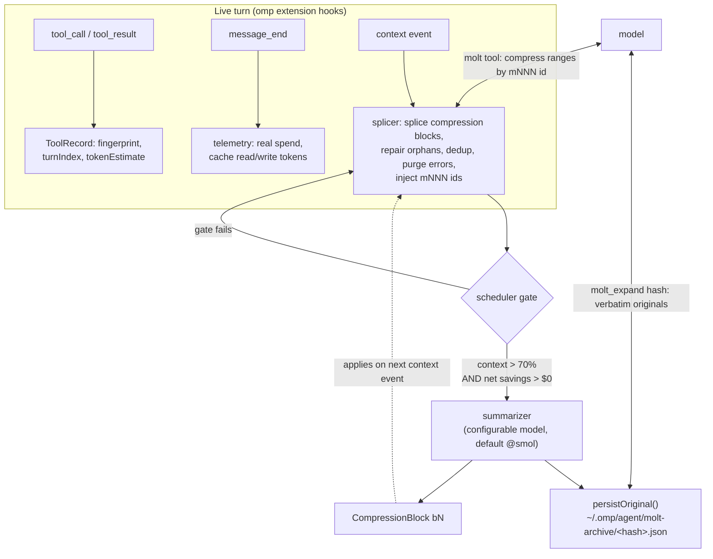

<p align="center">
  
</p>

# molt — shed stale context, keep the session

Local semantic context optimizer for coding agents: permanently shrinks session context by LLM-summarizing stale conversation ranges — but only when the projected token savings beat the one-time prompt-cache bust a rewrite costs. Shipped as an [omp](https://github.com/can1357/oh-my-pi) adapter; the engine is host-agnostic (see [Harness compatibility](#harness-compatibility)).

Structural compressors (truncation, headroom-style request trimming) shrink _requests_ but never shrink _history_: the full transcript keeps flowing through every call. molt replaces stale ranges in history with dense technical summaries, so every later request is actually smaller. Originals are archived on disk and recoverable verbatim at any time.

## How it works



molt never blocks a turn. The scheduler runs off-band (managed async): when the gate fires, it summarizes candidate ranges in the background and pushes compression blocks; the blocks splice into context on the **next** `context` event. The model can also molt eagerly via the `molt` tool — compression decisions stay in the model's hands either way.

### The cache-cost gate

Rewriting context busts the provider's prompt cache once. molt schedules that bust only when it pays for itself:

```
projectSavingsUsd = candidateTokens × cacheReadRate
                  − contextTokens × (cacheWriteRate − cacheReadRate)
                  − summarizerCostEstimate
```

Fire requires **all** of: auto mode on, context usage above `maxContextPercent` (default 0.70), stale candidates outside the protected turn window, and `projectSavingsUsd > 0` (or unknown pricing with >20k candidate tokens). This is the only policy in the codebase — no adaptive thresholds.

### Splice pipeline

Each `context` pass runs, in order: clone messages → apply compression blocks (assistant↔toolCall/toolResult groups kept atomic, summary inserted at the block's anchor) → repair orphaned tool pairs → dedup identical tool calls by input fingerprint → purge stale error outputs → inject sequential `<molt-id>mNNN</molt-id>` markers. Idempotent across passes.

A molted range becomes:

```
[Molted section: Overlap Error Fix]
Reported error: molt m163..m184 rejected — overlaps block b20. …
Expand originals: molt_expand hash=<hash>
```

`molt_expand` returns the original messages verbatim from the archive — summaries are lossy, the archive is not.

## Install

```sh
omp plugin install ~/projects/woss/molt   # or github:woss/molt
omp plugin doctor                          # verify loaded
```

Disable your structural compressor after parity (e.g. `omp plugin disable omp-headroom`) — molt replaces its role.

## Configuration

`.omp/molt.json` in the working directory; missing keys fall back to defaults:

| Key                 | Default   | Meaning                                                  |
| ------------------- | --------- | -------------------------------------------------------- |
| `auto`              | `true`    | scheduler-driven molting; `false` = model-invoked only   |
| `maxContextPercent` | `0.7`     | usage ratio above which the gate may fire                |
| `protectTurns`      | `2`       | tool outputs younger than this are never candidates      |
| `maxRangeTokens`    | `20000`   | max estimated tokens per summarized range                |
| `model`             | `"@smol"` | summarizer model spec, resolved via `ctx.models.resolve` |

## Tools & commands

- **`molt`** — model-invoked compression: `{topic, ranges: [{startId, endId, summary}]}` by `mNNN` id. Overlap errors name the conflicting block's span so the model can self-correct.
- **`molt_expand`** — `{hash}` → verbatim original messages from the archive.
- **`/molt stats`** — blocks, tokens saved, real spend, cache totals.
- **`/molt auto on|off`** — toggle the scheduler.
- **`/molt sweep [N]`** — mark the last N tool outputs for immediate summarization.

## Harness compatibility

**omp is the only shipped adapter**, but the engine is host-agnostic: `src/types.ts` defines the boundary (`HostAdapter` + `Summarizer`), and everything under `src/core/` talks to the host exclusively through it.

- It compiles against `@oh-my-pi/pi-coding-agent`'s `ExtensionAPI` (`pi.on`, `pi.registerTool`, `pi.appendEntry`, `ctx.models`, `ctx.getContextUsage`) and calls models through `@oh-my-pi/pi-ai`.
- It ships via the omp plugin manifest (`"omp": { "extensions": [...] }`) and installs with `omp plugin install`.
- Its persistence rides omp's session entry stream; its scheduling budget assumes omp's hook handler semantics (30 s, 2 s on shutdown).

Porting to another harness means writing `src/adapters/<host>.ts` (~100–200 lines of glue): implement `HostAdapter` (the four touchpoints plus session messages/metrics), implement `Summarizer` against that host's model API, and call core's `molt(adapter, summarizer)` the way `src/index.ts` does. Hosts without a context hook omit `onContextEvent` and the engine degrades to eager-tool-only mode. Message identity is the non-trivial part: block ranges reference stable per-message IDs, so a host without native IDs must stamp fingerprint IDs on messages in its adapter. The engine (scheduler, splicer, state, telemetry, archive) carries over untouched. No second adapter exists yet.

## Development

```sh
bun install
bun run typecheck   # tsc --noEmit
bun test            # vitest run
```

Architecture: `src/index.ts` (omp entry) · `src/types.ts` (`HostAdapter`/`Summarizer` boundary) · `src/adapters/omp.ts` (pi hook wiring + model call) · `src/core/` — `engine.ts` (host-agnostic wiring) · `scheduler.ts` (cache-cost policy) · `summarizer.ts` (LLM blocks) · `splicer.ts` (context transform) · `state.ts` (shapes + persistence) · `telemetry.ts` (spend) · `archive.ts` (originals) · `tools.ts` (`molt`, `molt_expand`) · `server/molt.ts` (paseo RPC stats handler).

## License

MIT
